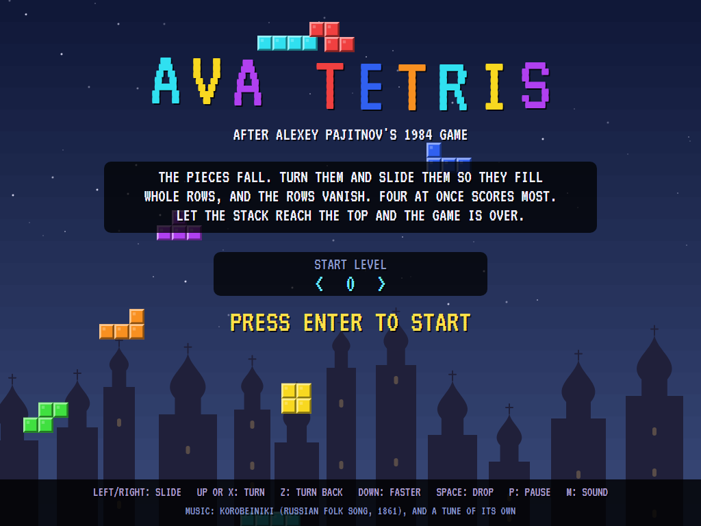
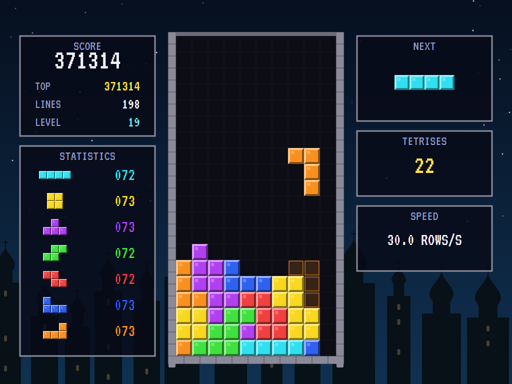
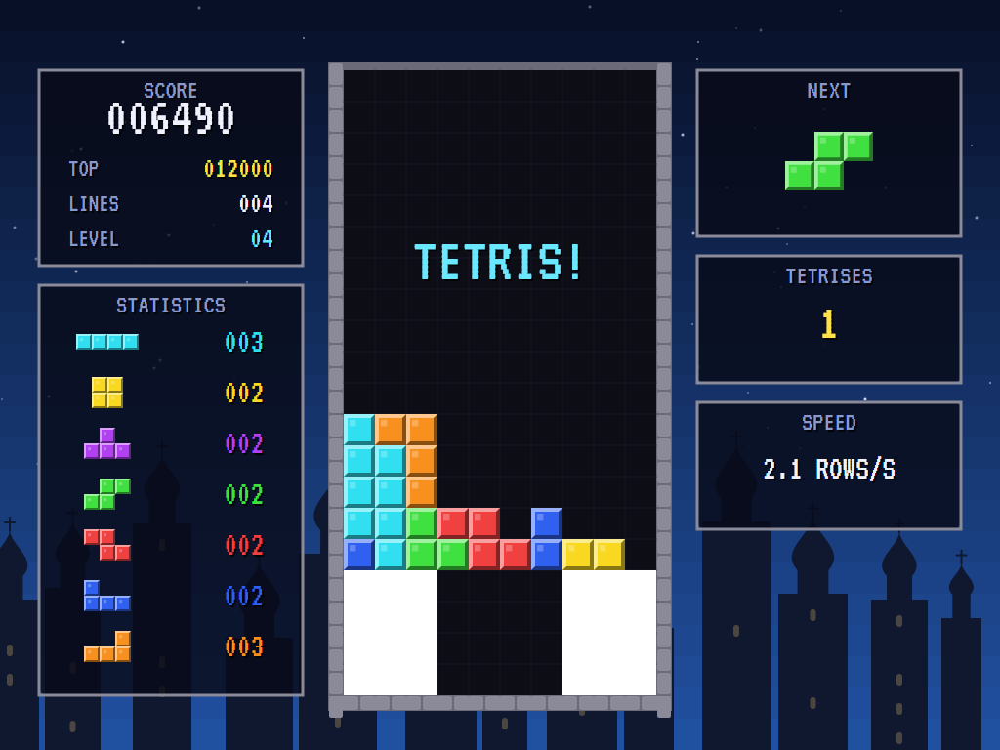
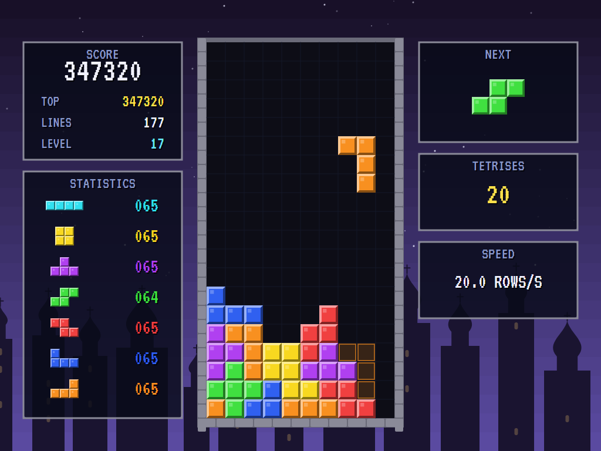
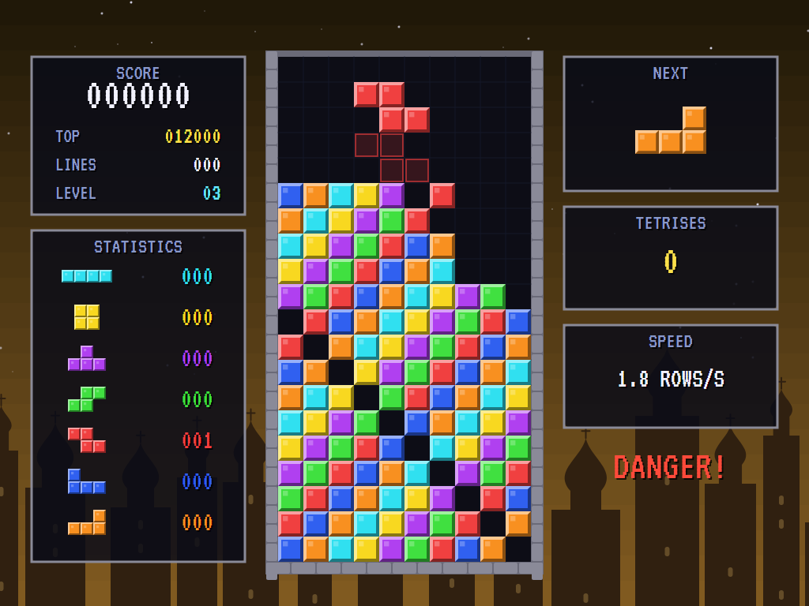
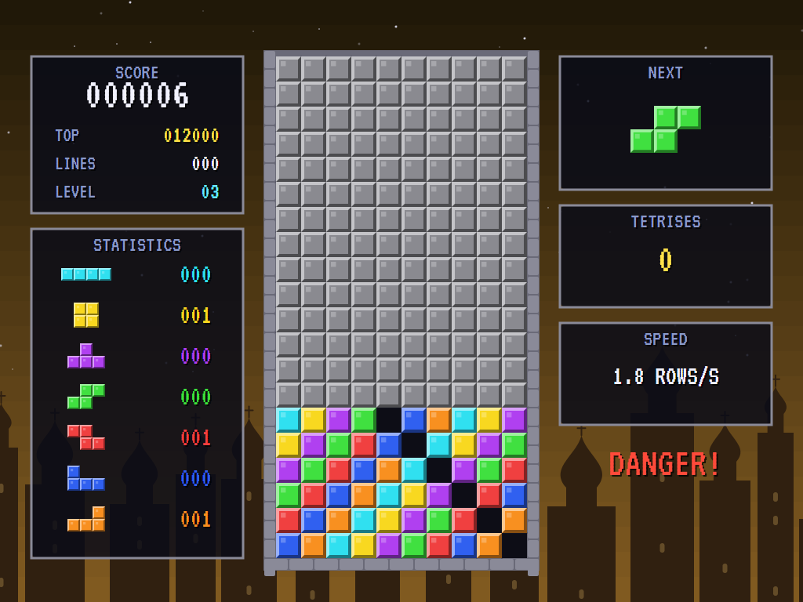
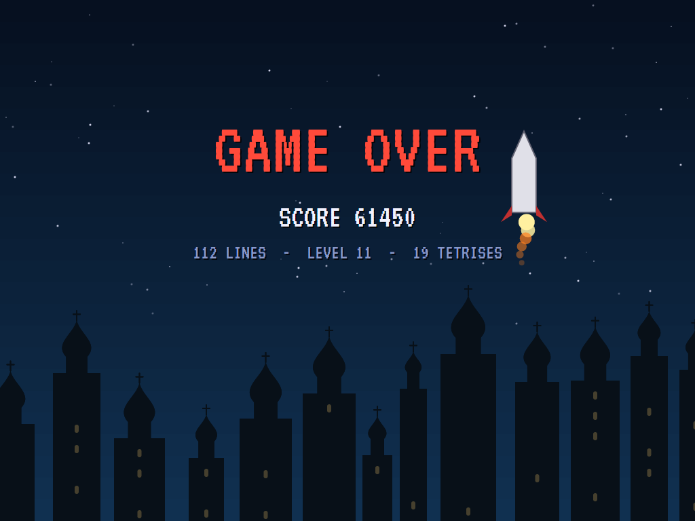
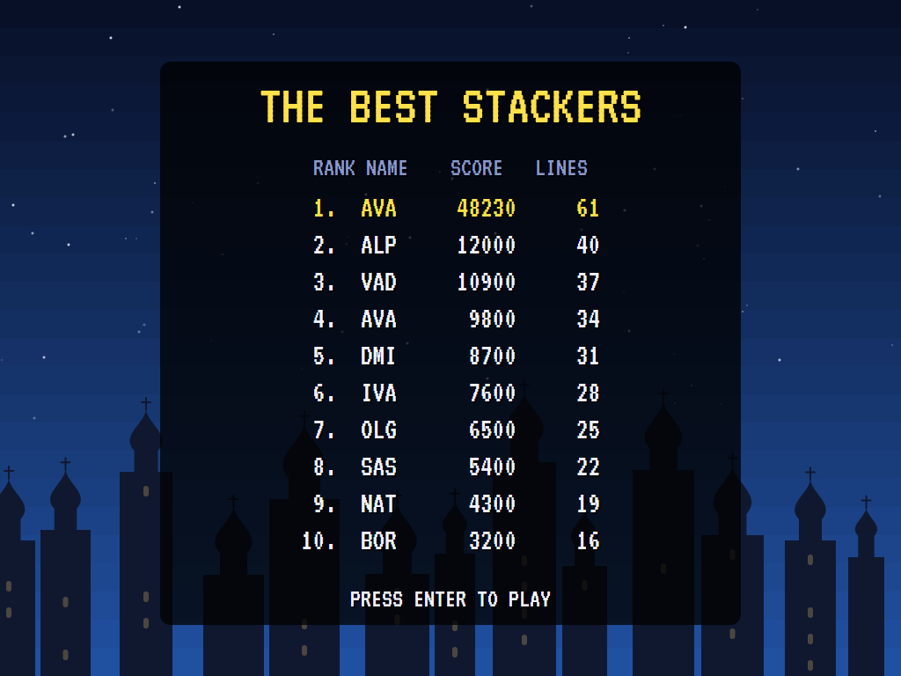

# AVA Tetris

[](https://github.com/Harlock123/AVATetris/actions/workflows/build.yml)

A falling-block puzzle game in the style of Alexey Pajitnov's 1984 **Tetris**, built with .NET 10 and Avalonia
UI. The pieces fall into the well one at a time. Turn them and slide them so they fill whole rows, and the
rows vanish. Four rows at once scores most. Let the stack reach the top and the game is over.

## Features

- **The seven pieces**, each four squares: the long I, the square O, the T, the S and Z, and the J and L.
  They come in shuffled bags of all seven, so there's never a long wait for the one you need.
- **Turn either way.** A piece against a wall or the stack is nudged a square aside, or up one, if that's
  what it takes to turn.
- **Slide** a square at a time, or hold to run across. **Soft drop** speeds the fall for a point a row;
  **hard drop** sends the piece straight down for two points a row. A faint outline shows where it will land.
- **Thirty speeds.** The level goes up every ten lines, and with it the speed: from a row every 48 frames at
  level 0 to one a frame at level 29, the way the 1989 home version had it. Choose a starting level from 0
  to 9 on the title screen; a game started higher stays there until its lines catch up.
- **Scoring** as the classic home versions: 40, 100, 300 and 1,200 points for one to four rows at once,
  times the level plus one. Rows flash and wipe away from the middle, and four at once flashes the whole
  well and gets a "Tetris!" from the voice.
- **The panel:** the score, the best score, lines and level, the next piece, a tally of how many of each
  piece has come, the Tetrises so far, and the speed in rows a second.
- **A sky for each level** behind a skyline of onion domes. When the stack nears the top, "DANGER!" flashes
  and the music hurries. A lost game greys the well out from the top down, and a big score sends a rocket up.
- **The music** is Korobeiniki, the Russian folk song of 1861. The title plays a balalaika dance of its own.
- **The attract mode** shows the computer player at work. For each new piece it tries every way to turn it
  and every column it can reach, drops it there in its head, and scores the stack it would leave: low
  landings and cleared rows are good, holes, ragged edges and deep wells are bad (Pierre Dellacherie's
  method, with El-Ashi's weights). It looks one piece ahead, using the next piece too. While the stack is
  low it keeps the right-hand column clear and waits for the long I.

## Screenshots

| The title | Playing | A Tetris |
|:---------:|:-------:|:--------:|
|  |  |  |
| Choose a starting level. | The computer player at level 0. | Four rows at once. |

| Level 7 | Danger | Topped out |
|:-------:|:------:|:----------:|
|  |  |  |
| A new sky every level. | The stack near the top. | The grey comes down. |

| Game over | The best stackers |
|:---------:|:-----------------:|
|  |  |
| A rocket for a big score. | |

The screenshots are made by the tests, which play the game in a real (headless) window; see
[Tests](#tests).

## Download and run

Ready-to-run builds for Windows, macOS and Linux, on both Intel/AMD and ARM, are on the
[Releases page](https://github.com/Harlock123/AVATetris/releases/tag/latest). **Latest build** is
rebuilt on every push to `main`. Each download is one self-contained executable: no .NET install is
needed.

| Platform | Archive |
|---|---|
| Windows | `AVATetris-win-x64.zip`, `AVATetris-win-x86.zip`, `AVATetris-win-arm64.zip` |
| macOS | `AVATetris-osx-arm64.tar.gz` (Apple silicon), `AVATetris-osx-x64.tar.gz` (Intel) |
| Linux | `AVATetris-linux-x64.tar.gz`, `AVATetris-linux-arm64.tar.gz`, `AVATetris-linux-arm.tar.gz` |

```bash
tar -xzf AVATetris-linux-x64.tar.gz     # or linux-arm64, linux-arm, osx-arm64, osx-x64
./AVATetris
```

On Windows, unzip and run `AVATetris.exe`. On macOS, if Gatekeeper refuses to open it, run
`xattr -d com.apple.quarantine AVATetris` once. Run with `--no-audio` for silence.

**Sound** comes through OpenAL Soft, built in for every platform. In a virtual machine the game
detects it and uses a larger audio buffer, so the sound doesn't break up.

**Gamepads** use SDL2, which is bundled for Windows, macOS and Intel/AMD Linux. ARM Linux builds need it
installed; without it the keyboard still works:

```bash
sudo apt install libsdl2-dev            # Debian / Ubuntu / Raspberry Pi OS
sudo pacman -S --needed sdl2-compat     # Arch / Omarchy
```

## Controls

| Action | Keyboard | Gamepad |
|---|---|---|
| Start | Enter or 1 | Start |
| Choose the starting level (title) | Left / right | Left / right |
| Slide | Left/right arrows, or A/D | Left stick / D-pad |
| Turn clockwise | Up, X or W | A |
| Turn back | Z or Ctrl | B |
| Soft drop | Down or S | D-pad down |
| Hard drop | Space | X or D-pad up |
| Pause | P or Esc | Start |
| Sound on/off | M | |
| Screenshot | Ctrl+S (to your Pictures folder) | |

On the high-score table, type your initials, or use up/down and Space, then Enter.

## Tests

```bash
dotnet test AVATetris.slnx
```

The game runs in fixed 60 Hz steps, so it plays the same at any frame rate. Everything that changes lives in
one world that can be copied. The tests check:

- **The pieces:** four squares in every turn, four different turns (one for the O); bags of all seven; new
  pieces at the top in the middle.
- **Moving and turning:** a slide, the pause before it repeats, and the wall; turning both ways, a press at
  a time; the long I nudged off the wall to turn, and a piece with no room left as it was.
- **Falling:** 48 frames a row at level 0 down to one at level 29; soft drop and hard drop, and their points;
  a piece settling where it can fall no further.
- **Rows:** a full row flashing, going, and the stack coming down; four at once for 1,200 times the level
  plus one; a level every ten lines, and a high start level held until the lines catch up.
- **The end:** no room for the next piece, or a piece settled above the well; the grey curtain, then
  initials for a good score.
- **The game:** choosing the starting level, the demonstration and the high scores, pause, the music
  hurrying, a copied world going its own way, and the keys, through to the piece.
- **The computer player:** the long I into a gap four deep, no holes made, and two minutes at level 0
  with lines cleared and a Tetris made, where just dropping every piece tops out with none.

`tests/AVATetris.Tests/PilotProbe.cs` reports how the computer player gets on, for tuning
(`TETRIS_PROBE=1`). Started at levels 0, 9, 15 and 19, it clears 290 to 390 lines, about one in ten
by Tetrises, before the speed of level 29 beats it. `TETRIS_PROBE=lazy` drops every piece where it comes
in, and tops out at once.

The screenshot tests draw the real screen in a headless window. To refresh the README's pictures:

```bash
TETRIS_SHOTS=$PWD/Images dotnet test tests/AVATetris.Tests --filter ScreenshotTests
```

## Building

```bash
dotnet build AVATetris.slnx
dotnet run --project src/AVATetris
```

Needs the .NET 10 SDK. The sounds, music and voice are made by `tools/make_sounds.py` (standard-library
Python, with the formant voice in `tools/speech.py`): `python3 tools/make_sounds.py` rewrites
`src/AVATetris/Sounds`.

## Project structure

```
AVATetris/
├── AVATetris.slnx
├── src/AVATetris/
│   ├── Engine/
│   │   ├── GameEngine.cs        # States, the title's level choice, topping out, the music, the demonstration
│   │   ├── Sim.cs               # The rules step by step: sliding, turning, falling, settling, rows, levels
│   │   ├── Well.cs              # The well, the seven pieces and their turns, the stack
│   │   ├── World.cs             # Everything that changes, kept together so it can be copied
│   │   ├── Pilot.cs             # The computer player (the demonstration, and the tests)
│   │   ├── HighScoreTable.cs, InitialsEntry.cs
│   │   ├── InputHandler.cs, ControllerManager.cs  # Keys and an SDL2 gamepad
│   │   └── SoundManager.cs      # Effects, music and voice through OpenAL
│   ├── Audio/                   # The OpenAL engine (from the author's AVABand)
│   ├── Views/GameCanvas*.cs     # The well, the panels, the skies and domes, the title
│   └── Sounds/                  # The synthesised effects, music and voice
├── tests/AVATetris.Tests/       # Gameplay and screenshot tests
├── tools/make_sounds.py, tools/speech.py
└── Images/                      # Screenshots
```

## About and licence

AVA Tetris © 2026 Lonnie Watson, under the [MIT License](LICENSE).

*Tetris* was created by Alexey Pajitnov in 1984; the name *Tetris* and the game's trade dress belong to The
Tetris Company. AVA Tetris is an independent, unofficial game in its style. Its graphics, sounds and code
are its own; nothing is taken from any official game's program, graphics or sound. It is not affiliated
with or endorsed by any rights holder. Korobeiniki is a traditional song, arranged here from scratch.
